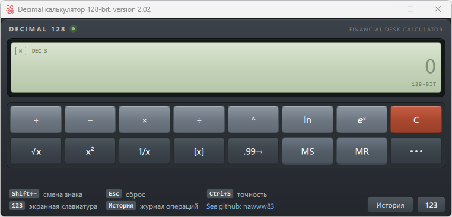

# Калькулятор Decimal 128-бит

  
  
  

Калькулятор с поддержкой 128-битной десятичной арифметики и удобным интерфейсом на Qt/QML.

Подходит для финансовых вычислений с большим диапазоном значений.

  

## ✨ Возможности

- ✅ Разделитель тысяч
- ✅ Регулируемое количество знаков после запятой от 0 до 18
- ✅ История операций
- ✅ Отображение текущей операции и первого операнда во вспомогательном поле
- ✅ Повторное выполнение текущей операции клавишей Enter, включая ее длительное нажатие
- ✅ Горячее редактирование текущего числа с помощью курсора ввода
- ✅ Выдвижная экранная клавиатура: цифры, клавиша `00`, десятичный разделитель, операторы, Backspace и `=`
- ✅ Индикатор занятой памяти `M` на дисплее
- ✅ Выдвижная панель редких операций: `M₁₂₈`, `ξ₆₄`, `ξ₁₂₈`, `p·q` (кнопка `⋯`)
- ✅ Поддержка работы с большими числами: 128-бит целой части
- ✅ Факторизация целых чисел (многопоточно): разложение видно в нижней строке ЖК и в журнале операций
- ✅ Основные операции:
  - Сложение/вычитание
  - Умножение/деление
  - Возведение в степень
  - Корень квадратный / возведение в квадрат
  - Обращение, 1/x
  - Отбрасывание дробной части / умное округление девяток
  - Генерация случайных 64- и 128-битных целых чисел

## ⚙️ Основные особенности

- Смена знака числа осуществляется вводом `Shift + -`
- Количество знаков после запятой задаётся через `Ctrl + S`
- Нажатие `Esc` или кнопки `C` полностью сбрасывает калькулятор
- Интерфейс построен с использованием технологии QML

## 📊 Характеристики Decimal 128

### Диапазон значений

| Параметр | Значение |
|----------|----------|
| **Целая часть (максимум)** | 2^128 - 1 |
| **Целая часть (минимум)** | -(2^128 - 1) |
| **Дробная часть (точность)** | до 18 знаков после запятой |

## 📥 Скачать

[📦 Скачать последнюю версию для Windows](https://disk.yandex.ru/d/FcqdjAe5ofcNHQ)

## 📝 История версий

### Версия 2.04, 25.10.2026

- Иконка приложения перерисована векторно и собирается во всех размерах: 16, 20, 24, 32, 40, 48, 64, 96, 128 и 256 px (раньше было только 32 и 64)
- Иконка адаптивная: на 16–24 px показывается крупное «DC», с 32 px — «DC» над «128»; фон по-прежнему прозрачный, цвет — красный
- Крупные размеры (128 и 256 px) хранятся в PNG, поэтому иконка остаётся чёткой в проводнике, на панели задач и в крупных представлениях

### Версия 2.03, 25.10.2026

- Результат факторизации показывается в нижней строке ЖК: `= 3 · 5 · 823` — раньше он был виден только в журнале операций
- Ответ в журнале оформлен как обычный ответ: `<-- [Ответ]: 3 · 5 · 823` вместо отдельной строки `[Факторы]`
- Множители пишутся в привычной записи: `2^2 · 3 · 5` вместо `{2^2; 3^1; 5^1}`, единичные степени не выводятся
- Для простого числа добавляется пометка «простое число», для `0` и `1` — «не раскладывается»
- Время вычисления вынесено в отдельную метку справа в записи журнала
- Уменьшено расстояние между триадами цифр: разделителем стал узкий пробел, длинные числа занимают меньше места на ЖК

### Версия 2.02, 25.10.2026

- Исправлена точность цепочек операций: результат больше не перечитывается с округлённого дисплея, а используется с полными 18 внутренними знаками
- `1/7`, затем `1/x` снова даёт `7`, а не `6,9979`; `ln`/`exp` и другие унарные операции работают так же
- Если число отредактировано на дисплее вручную, вычисления выполняются по отредактированному значению

### Версия 2.01, 25.10.2026

- Исправлена факторизация: `p·q` раскладывает то число, которое показано на дисплее
- Ранее после `8 + 8 =` кнопка `p·q` факторизовала предыдущий результат `16`, даже если на дисплее уже были `M₁₂₈` или `ξ₆₄`

### Версия 2.00, 25.10.2026

- Интерфейс переработан в стиле настольного бухгалтерского калькулятора: корпус прибора, ЖК-дисплей с индикаторами, объёмные клавиши
- Экранная клавиатура получила полный цифровой блок с операторами и клавишей `00`
- История операций оформлена как бумажный журнал
- Добавлен индикатор занятой памяти `M` на дисплее
- Длинные числа на дисплее автоматически уменьшают размер шрифта

### Версия 1.11, 24.10.2026

- История операций перенесена из консольного журнала в выдвижную панель QML (кнопка «История»)
- Приложение собирается без консольного окна
- Исправлена кнопка «Схлопнуть машинный хвост девяток»: шум после цепочки девяток больше не ограничен четырьмя цифрами и не может превышать длину самой цепочки
- `9800,999999999999983616` теперь приводится к `9801`, а значащие числа вроде `0,999983616` не затрагиваются
- Добавлен регрессионный тест на `FixNines`
- Экранная клавиатура вынесена в выдвижную панель ввода
- Панель редких операций: выдвижная панель и компактная сетка кнопок
- Факторизация: потоки привязываются только к P-ядрам (гибридные Intel, ARM64 Windows, Linux)

### Версия 1.10, 10.10.2026

- Внутренняя точность переведена на максимум (18 знаков после запятой)

### 03.10.2026

- Добавлена операция возведения в степень

### Версия 1.09, 16.09.2026

- Расширено количество знаков после запятой до 18
- Ускорена факторизация целых чисел
- Проверена сборка на Linux

### Версия 1.08, 01.03.2026

Рефакторинг:

- библиотеки `U128` и сопутствующих компонентов
- инициализации приложения
- логирования результатов

### Версия 1.07, 21.12.2025

- Ускорен алгоритм факторизации целого числа благодаря использованию алгоритма Ленстры

### Версия 1.06, 09.11.2025

- Ускорен алгоритм факторизации целого числа благодаря использованию теста простоты Миллера-Рабина
- Улучшена эффективность сочетания методов Полларда и Ферма

### Версия 1.05, 22.10.2025

- Добавлено сохранение количества знаков после запятой при выходе из программы
- Базовые числа переведены на более систематизированные классы `I128/U128`
- Улучшена точность деления двух больших чисел

### Версия 1.04, 28.07.2025

- Добавлен вывод о точности извлечения корня квадратного из целого числа
- Добавлен генератор псевдослучайных чисел: 64-бита и 128-бит

### Версия 1.03, 18.05.2025

- Добавлена возможность сохранения результата в память
- Добавлено округление всех девяток для более корректного счёта

### Версия 1.02, 27.04.2025

- Добавлены операции:
  - квадрат числа
  - обратное число, `1/x`
- Добавлена факторизация целого числа на простые множители
- Улучшен интерфейс

### Версия 1.01, 21.04.2025

- Добавлена операция извлечения квадратного корня
- Исправлена ошибка умножения, когда оба операнда отрицательные и по модулю больше единицы

## ℹ️ Другое

Сборка приложения проверялась с библиотекой **Qt 6.11.1** под Windows 11.
